<div align="center">



<br>


**A small green terminal in the corner of your screen that listens to GitHub<br>and tells you which open issues are actually worth your time.**

[`WHAT IT IS`](#-what-it-is) · [`SIGNAL PATH`](#-signal-path) · [`STATION CONTROLS`](#-station-controls) · [`GO ONLINE`](#-bring-the-station-online) · [`TUNING`](#-tuning)

</div>

## `>` WHAT IT IS

Twice a day a cloud job sweeps GitHub for repositories that are gaining stars fast, in two lanes. It throws away every repo that does not merge outside contributors, keeps only issues nobody has claimed, scores them for how much real engineering they need, and beams a 20 KB feed down to a tab that takes one sixteenth of your screen.

<p align="center">

</p>

| LANE | LISTENING FOR |
|---|---|
| `ai-infra` | agents, inference serving, model infra: crewAI, pydantic-ai, vLLM, SGLang, Ray, Mooncake, TensorRT, and whatever is breaking out this week |
| `systems` | bleeding-edge Rust, C++ and Zig, plus research implementations: databases, compilers, runtimes, GPU kernels |

Click the tab and it opens into the full console: the ranked list, tags for language, sector, kind and effort, filters, and a log of the last four days of sweeps. Click any signal to open the issue.

## `>` SIGNAL PATH



<details>
<summary><b><code>&gt; DECODE STAGE 01 // DISCOVER</code></b></summary>
<br>

GitHub search across about 20 topic and language queries, ranked by **stars per day** rather than total stars, so a three-month-old repo at 9k outranks a ten-year-old one at 40k. A fixed list in `scanner/seeds.json` is always scanned on top of that.

</details>

<details>
<summary><b><code>&gt; DECODE STAGE 02 // GATE</code></b></summary>
<br>

A repo is dropped if it is archived, if fewer than 2 pull requests from outsiders were merged in the last 90 days, or if its CONTRIBUTING file closes the door and outsiders rarely get merged anyway. Merged PRs count for more than wording.

</details>

<details>
<summary><b><code>&gt; DECODE STAGE 03 // FILTER</code></b></summary>
<br>

An issue survives only if it is open, under 45 days old, unassigned, has no open or merged PR linked to it, and nobody in the comments has said some form of "I'll take this".

</details>

<details>
<summary><b><code>&gt; DECODE STAGE 04 // SCORE</code></b></summary>
<br>

`bge-small-en-v1.5`, a small embedding model, places each issue by kind, sector and substance. That is blended with body size, reactions, labels, how fast the repo is rising and how fresh the issue is. Verdicts are cached by the issue's `updated_at`, so an unchanged issue is never scored twice.

No API keys: the model runs on the Actions runner for free.

</details>

<details>
<summary><b><code>&gt; DECODE STAGE 05 // RANK</code></b></summary>
<br>

Substance first. Anything a maintainer labelled as docs is forced to the bottom of the list. Usage questions are cut by half. One- and two-word titles and promo spam are pushed down hard. At most 6 issues per repo, 240 in total.

</details>

## `>` STATION CONTROLS

<p align="center">

</p>

**HALT** stops everything on the laptop in one click: no syncing, no system probing, no animation. Pick a duration, confirm, done. **RESUME** is one click too.

| | |
|---|---|
| **BUSY GUARD** | CPU over 60%, memory over 90%, or battery under 20% unplugged: the tab stands down for an hour |
| **STORAGE** | one gzipped feed and a small state file; nothing older than four days survives |
| **FOOTPRINT** | a 4 MB executable, about 30 MB of RAM for the app itself |
| **STARTUP** | launches with Windows; toggle it under STATION |

## `>` BRING THE STATION ONLINE

```console
$ git clone https://github.com/onepizzateam/vothub && cd vothub/app
$ cargo build --release --features custom-protocol
$ ./target/release/vothub.exe
```

1. Push the repo to your own **public** GitHub repo.
2. `Actions` → `vothub-scan` → `Run workflow`. Only the first sweep is manual.
3. Point the tab at your repo: click it → `STATION` → `FEED REPO` → `owner/name`. Until you do, it listens to `onepizzateam/vothub` (`DEFAULT_REPO` in `app/src/main.rs`).

> [!TIP]
> After that first run the sweep is on a schedule and needs nothing from you.

> [!NOTE]
> Building needs Rust and the Visual Studio C++ Build Tools. The tab is Windows-only.

## `>` TUNING

<details>
<summary><b><code>&gt; OPEN DIAL PANEL</code></b></summary>
<br>

| DIAL | LOCATION |
|---|---|
| repos always scanned | `scanner/seeds.json` |
| discovery queries, issue window, ranking weights, reference phrases | top of `scanner/scan.py` |
| sweep times | `cron` in `.github/workflows/scan.yml` (UTC) and `SLOT_HOURS` in `app/src/main.rs` |
| busy thresholds | constants at the top of `app/src/main.rs` |
| these panels | `python docs/make_panels.py` |

</details>

<details>
<summary><b><code>&gt; READ FIELD NOTES</code></b></summary>
<br>

> [!WARNING]
> HALT silences the laptop, not the cloud. The Action keeps its schedule; disable the workflow on GitHub to stop that too.

- GitHub's scheduler runs late, often by 5 to 30 minutes. The sweep is set 45 minutes ahead of the tab, and the tab rechecks every 10 minutes if the feed is not there yet.
- GitHub pauses scheduled workflows on repos with no commits for 60 days and emails a one-click re-enable.
- An embedding model is a blunt instrument. It ranks well at the top and gets vague in the middle. If the list drifts, tune the reference phrases.

</details>

<div align="center">
<br>

```
> END OF TRANSMISSION
```

<sub>The look is a tribute to lonely-signal-station games. Not affiliated with any of them.</sub>

</div>
